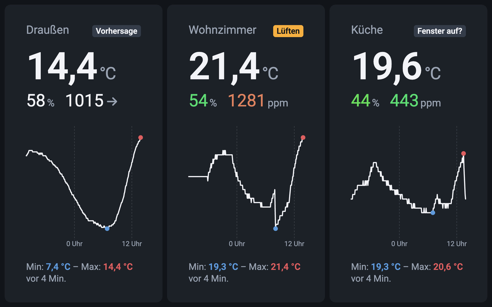
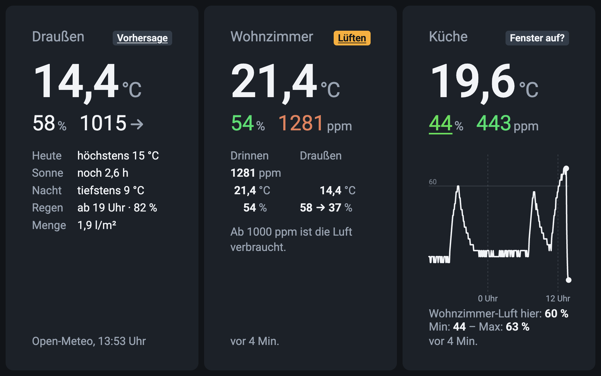
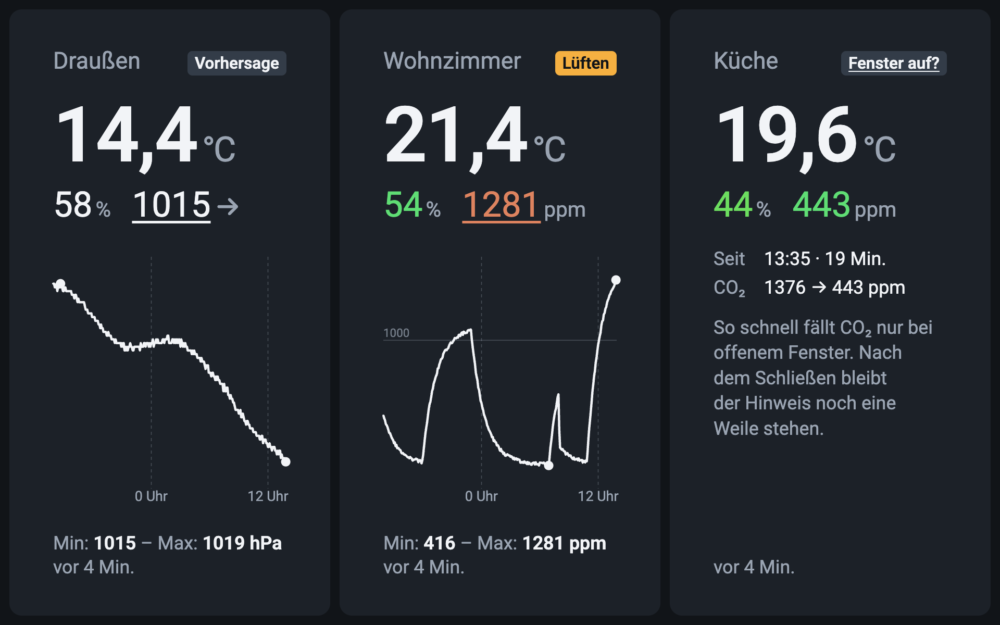

# Netatmo Weather Dashboard

A wall display for a Netatmo weather station: an old Android tablet hangs on
the wall and shows the house and the weather, readable from two metres away,
in passing, without anyone touching it.

**It answers questions instead of listing sensors.** Should I air the room?
Is it colder outside than inside? How cold was the night? Is a window still
open? Is a module about to go flat? The Netatmo app shows every value; this
page shows the answers, and the values behind them one tap away.



Everything runs inside the house: a poller and a small web server on a machine
on the LAN, and the tablet's browser. There is no cloud component of its own
and no access from outside — the Netatmo app covers that.

*The screenshots show invented data from `npm run demo`, the forecast
included. The dashboard's own text is German.*

## What it shows

One tile per module, outdoor first. Each shows the temperature, humidity and
CO₂ (outside: the air pressure with its three-hour tendency), the last 24
hours as a curve with the day's low and high, and how old the values are.

- **Airing**, per room against the outdoor module, decided on CO₂ and on
  **absolute** humidity — 90 % at 5 °C outside is drier air than 55 % at
  21 °C inside, which relative humidity gets backwards. "Lüften", "Kurz
  lüften" or "Nicht lüften" beside the room's name, and a tap shows why.
  While no rule applies, a quiet "Lüften?" answers what airing would do.
- **An open window**, guessed from CO₂ falling and the room following the
  outside temperature: "Fenster auf?", with since when and why behind a tap.
- **The night's low** on the outdoor tile in the morning.
- **A forecast** from Open-Meteo behind the outdoor tile's "Vorhersage": the
  rest of today, the sunshine left, the night, rain with its amount.
- **Battery, radio and modules out of reach** as a hint on the tile, and a
  tile whose values are older than 35 minutes is dimmed.
- **The wall tablet off power**, from the kiosk browser's own reading: a line
  at the foot once its battery is down to 40 %, hours before it runs flat and
  waits for someone to press its power button.
- **Evening and night.** From shortly before sunset the page dims; at night it
  turns black and shows only each room's name, temperature and airing label,
  and with a kiosk browser that can, the screen goes off. A tap wakes a tile
  for 30 seconds.

A tap on humidity, CO₂ or pressure swaps the curve for that quantity's for 30
seconds, and a tap on the curve itself shows its last seven days. Once a
curve reaches a key value, a line marks it: frost on the outdoor temperature,
60 % humidity and 1,000 ppm CO₂ in a room. Under a room's humidity curve, the other rooms' air appears in this
room's terms ("Wohnzimmer-Luft hier: 59 %"), so rooms at different
temperatures can be compared.

| Behind a tap: forecast, airing reason, humidity across rooms | The other curves and the window guess |
| --- | --- |
|  |  |

Why each of these works the way it does — the airing rules and their
thresholds, the window guess, the plausibility filter, the night rendering —
is in [`docs/design.md`](docs/design.md).

## What it needs

- **A Netatmo Smart Weather Station:** the base unit and the outdoor module,
  plus up to three additional indoor modules. Rain and wind modules are
  stored but get no tile yet.
- **Node.js 22.13 or newer.** There is nothing to install: the project has no
  dependencies.
- **A machine on the LAN that stays awake** for the poller and the server — a
  Raspberry Pi, a home server, anything that runs Node. A laptop does for
  setting up: the poller catches up on whatever it missed.
- **An Android tablet** with Android 10 or later, Chrome and Android System
  WebView 139 or later, and a screen that reports **1280×800 CSS pixels** in
  landscape (a 10" tablet at 1920×1200 does). The layout is measured against
  that size. Fully Kiosk Browser keeps the page on screen, and its PLUS licence
  switches the screen off at night.

## Try it without a station

```sh
npm run demo
```

Seeds a temporary database with a week of invented values and serves it on
<http://localhost:8090>, with an invented forecast — no Netatmo account, no
`.env`, no network. The scene is the one in the screenshots, whenever it is
started. The values end at the start and do not grow, so after 35 minutes the
tiles turn stale; restart it for fresh ones.

## Setting it up

### 1. Your own Netatmo app

The poller reads your station through Netatmo's API with your own app, and
you accept Netatmo's terms for it yourself.

1. Sign in at <https://dev.netatmo.com/apps> with the account that owns the
   station and create an app. Name and description are up to you.
2. **Leave the redirect URI empty.** The portal only offers the token
   generator while none is set, and the token generator is how this project
   gets its first token — there is no login flow.
3. Copy `.env.example` to `.env` and enter the app's client ID and client
   secret as `NETATMO_CLIENT_ID` and `NETATMO_CLIENT_SECRET`. They stay needed:
   every token renewal is signed with them.

### 2. The first token pair

On the same app page, use the **token generator** with the scope
`read_station` and write both tokens into `token.json` next to
`package.json`:

```json
{
  "access_token": "...",
  "refresh_token": "..."
}
```

No expiry is needed; the first poll renews the pair and records one.

**`token.json` is live credential state, not configuration.** Netatmo rotates
the refresh token: every renewal invalidates the previous one, and the poller
rewrites the file each time. Run exactly one poller against it — a lock file
(`token.json.lock`) refuses a second one — and do not copy the file to another
machine while the first one still polls. If the chain ever breaks, generate a
new pair in the portal and write it into the file again. A leaked token file
counts as burned: generate a new pair.

### 3. The poller

```sh
npm run poll:once   # one cycle, to check the setup
npm run poll        # every ten minutes, until Ctrl-C
```

The database is created on the first start, at `DATABASE_FILE` (default
`./data/weather.sqlite`), and is one file — a backup is a copy.

**The first start imports the station's whole history** at five-minute
resolution, spread over ordinary cycles of 50 requests each to stay clear of
Netatmo's rate limits. That is about 90 requests per module and year: three
modules with four years of history took about five hours, because Netatmo
answers some requests with an error and those cost a cycle. The log says
`catching up` until it is done; stopping and restarting in between loses
nothing. Afterwards each cycle fetches the new points, and after any outage
the next cycle closes the gap.

### 4. The server

```sh
npm run serve
```

Serves the page and its JSON API on `http://<host>:8080` (`SERVER_HOST`,
`SERVER_PORT`). It runs next to the poller as its own process, only reads the
database, needs no Netatmo credentials and refuses to start before the poller
has created the database. Open `http://<host>:8080/` on the tablet.

On macOS the firewall may ask whether `node` may accept incoming connections;
the tablet needs it to.

### 5. Your house

`.env.example` lists every setting with its default:

| Setting | What it is | Default |
| --- | --- | --- |
| `FORECAST_LAT`, `FORECAST_LON` | where the forecast is for; two decimals are enough | none: no forecast |
| `TIME_ZONE` | the house's IANA time zone; the tablet must run in the same one | the server's |
| `EVENING_SUNSET_OFFSET_MIN` | when the evening starts, in minutes after sunset; negative is before, for a room that is dark before the sky is | `-15` |
| `EVENING_FALLBACK_SUMMER`, `EVENING_FALLBACK_WINTER` | when the evening starts without a forecast | `20:30`, `17:00` |
| `NIGHT_FROM`, `DAY_FROM` | the night rendering, from bedtime until getting up; give the kiosk browser's screen schedule the same two times | `22:00`, `06:00` |

The server checks them at start and refuses a malformed one. Rooms are named
as in the Netatmo app, and new modules appear on their own.
`http://<host>:8080/?diag` shows what the tablet reports — viewport, engine
version, mode and time zone — and `?mode=day`, `?mode=evening` or
`?mode=night` pins a mode, for looking at the night by daylight.

### 6. The tablet

[`docs/tablet-setup.md`](docs/tablet-setup.md) takes an old Android tablet
from a factory reset to the wall: its own Google account, updating Chrome and
the WebView, Fully Kiosk Browser, the screen at night, charging, and the
recovery tests after a reboot, a lost Wi-Fi and a power cut.

### 7. A host that stays up

Once the wall hangs, poller and server should start with the machine and
restart after a crash — two services, for example two systemd units on a
Raspberry Pi, each running its npm script with the project directory as the
working directory. Give the host a fixed address on the LAN, so the tablet's
start URL keeps working. The host need not run without a break: after a
reboot or an outage the poller fetches what it missed.

## How it is built

    Netatmo API ──every 10 min──> poller ──writes──> SQLite <──reads── server ──> tablet(s)
                                     │                                   ↑
                                token.json                      Open-Meteo, hourly

- **The poller** fetches each module's new points with `getmeasure`, which
  serves the full history, so it continues after the newest stored point,
  and the status (battery, radio) with `getstationsdata`.
- **SQLite** through the built-in `node:sqlite`: one row per module and
  point, about 3.8 MB per module and year. Everything is stored; faulty
  points are left out when the server reads, never deleted.
- **The server** is plain `node:http`, read-only on the database, and the
  only part that calls out besides the poller: hourly, for the forecast.
- **The page** is plain HTML, CSS and ES modules, with no framework and no
  build step.

**Why plain JavaScript and no TypeScript:** the wall page runs without a build
step, so it keeps working in a tablet whose browser engine stops getting
updates, and the file served is the file in the repository; the calculations
that matter are pure functions under unit tests.

`npm test` runs the tests with Node's built-in test runner. `CLAUDE.md` holds
the conventions for working on the code.

## Data sources and terms

- **Netatmo.** Neither Netatmo's data nor credentials are part of this
  repository. Everyone who runs it registers their own app and accepts
  [Netatmo's API terms](https://dev.netatmo.com/) themselves. This project is
  not affiliated with Netatmo.
- **Open-Meteo.** [Weather data by Open-Meteo.com](https://open-meteo.com/),
  licensed under [CC BY 4.0](https://creativecommons.org/licenses/by/4.0/).
  The data is changed: the page derives its rows from the forecast — the
  sunshine the day has left, the night's low, rain with its amount, wind and
  felt temperature only when they stand out — rather than showing it as
  delivered. The wall names Open-Meteo under the forecast. The free API is
  for non-commercial use only; everyone who runs the dashboard accepts
  [Open-Meteo's terms](https://open-meteo.com/en/terms) themselves.

## Licence

[MIT](LICENSE).
